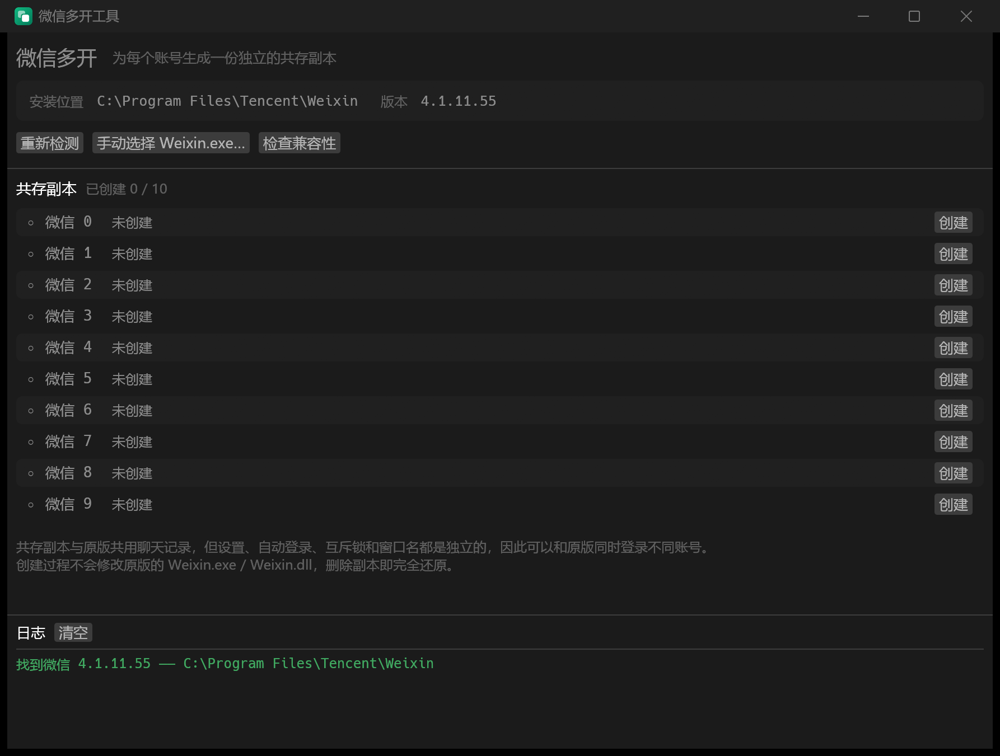

# wx-tool — 微信多开（共存）

Windows x64 上的微信 4.x 多开工具，Rust + egui 实现，带图形界面。

思路来自 [zetaloop/BetterWX](https://github.com/zetaloop/BetterWX)（Unlicense）的 `coexist.py`。



## 它做了什么

给微信生成一份编号为 `n`（0~9，最多十个）的**共存副本**，副本与原版可以同时运行、
登录不同账号：

```
<安装目录>\Weixin.exe            ← 原版，不动
<安装目录>\Weixin2.exe           ← 新生成的副本启动器
<安装目录>\<版本>\Weixin.dll     ← 原版，不动
<安装目录>\<版本>\Weixin.dl2     ← 新生成的副本主模块
```

原理是**纯二进制补丁 + 文件克隆**：把原文件复制一份，在副本里改掉几个字节，
让副本使用独立的资源名。一共 5 处改动，每处只改 1 个字节：

| 文件 | 特征 | 作用 |
|---|---|---|
| `Weixin.exe` | `Weixin.dll` 的 UTF-16LE 字符串 | 让副本启动器去加载 `Weixin.dl{n}` |
| `Weixin.dll` | `global_config` 的构造代码 | 设置存储隔离（→ `global_conf{n}g`） |
| `Weixin.dll` | `host-redirect.xml` | 自动登录隔离（→ `host-redirect.xm{n}`） |
| `Weixin.dll` | `XWeChat_App_Instance_Identity_Mutex_Name` | **单实例互斥锁改名 —— 多开的关键** |
| `Weixin.dll` | `xWechatWindow` | 窗口名隔离 |

所有替换都等长，文件大小不变，因此不需要修 PE 校验和或重定位。

**副本与原版共用聊天记录**，独立的是设置存储、互斥锁、窗口名。
每个副本有自己的 `Weixin.dll`，所以理论上还能各自定制提示音。

另外，`host-redirect.xml → host-redirect.xm{n}` 这条补丁（BetterWX 注释说它管自动登录）
在 4.1.x 上**盘上从没产生过对应文件** —— `net`、`net_1`、`net_2` 里全是原名的
`host-redirect.xml`。它在这个版本上多半已经失效，留着只是无害。

## 相对 BetterWX 的改动

- **图形界面**，十个槽位一览，可创建 / 重建 / 删除 / 启动。
- **同时支持微信 4.0.x 和 4.1.x**。`global_config` 在 4.1 换了代码生成方式
  （编译器改用两条重叠的 8 字节立即数写入），BetterWX 原版特征在 4.1 上匹配不到。
  两种形态都内置了，会自动选中命中的那一个。
- **特征缺失时报错中止**，而不是打印一句 `[WARN] SKIPPED!` 继续跑 ——
  静默跳过会产出一个「看起来成功、其实没隔离干净」的坏副本。
- **两阶段提交**。BetterWX 先写 `Weixin{n}.exe` 再去处理 DLL，一旦 DLL 特征失配，
  用户就留下一个指向不存在文件的启动器。这里两个文件都补完才一起就位，
  中途失败不留痕迹。
- **版本目录按数字排序**。BetterWX 取 `iterdir()` 的第一个结果（文件系统顺序），
  微信升级后留下旧目录时会打错文件。
- **升级检测**。微信自动升级会新建版本目录，副本的 DLL 留在旧目录里就失效了；
  界面会标出「微信已升级 —— 需重建」。写入前还会按安装根目录重新推导一次版本目录：
  界面开着不动的时候微信可能刚好升级完，拿过期的路径去创建会把 DLL 写进旧目录，
  `create` 一路报成功，双击副本却是「由于环境异常，不能继续使用。」
- **按需 UAC 提权**。只读操作（检测、列表、兼容性检查）不弹 UAC，
  只有真的要写 `Program Files` 且当前写不进去时才提示提权重启。
- **内存占用**。189 MB 的 DLL 不整个读进内存：先只读映射原文件做特征扫描，
  确认无误后 `CopyFileEx` 复制，再映射副本原地改那 4 个字节。

## 使用

```
cargo run --release
```

或者直接运行 `target\release\wx-tool.exe`。

界面上点「创建」即可。写入 `Program Files` 需要管理员权限，程序会在需要时提示提权。

删除副本 = 完全还原，因为原版文件从头到尾没被碰过。

## 图标

图标由脚本生成，改了要重新跑：

```powershell
pwsh packaging\make-icon.ps1
```

产出 `assets\icon.ico`（16~256 共 8 个尺寸）和 `assets\icon-256.png`。
前者由 `build.rs` 通过 `winresource` 编进 exe 的 Windows 资源段（文件管理器、
快捷方式显示的就是它），后者在运行时用作窗口和任务栏图标。

图形是两个叠放的圆角方块 —— 通用的「副本 / 多开」意象。**刻意没有用微信的双气泡图形**，
那是腾讯的注册商标，仿了既容易混淆也不合适。

小尺寸（≤64）在 .ico 里以传统 BMP(DIB) 格式存储而非 PNG：PNG 压缩的图标条目
在部分 shell 场景下不被识别。128/256 仍用 PNG，避免文件过大。

> 已知小瑕疵：「设置 → 应用」列表里这条记录显示的是通用图标。
> `ARPPRODUCTICON` 在 per-user 安装下不会写入 `DisplayIcon`，这是 Windows Installer
> 的行为，唯一可靠的绕法是把 14 MB 的 exe 再嵌一份进 MSI，不划算。
> exe 本身、开始菜单快捷方式、任务栏图标都是正常的。

## 打包成 MSI

```powershell
pwsh packaging\build-msi.ps1
```

产出 `target\wix\wx-tool-<版本>-x64.msi`（约 4.6 MB）。

**这是仅当前用户（per-user）的安装包**：

- 装到 `%LOCALAPPDATA%\Programs\wx-tool`，**安装过程完全不需要管理员权限**
- 在开始菜单放一个「微信多开工具」快捷方式
- 出现在「设置 → 应用」里，可正常卸载
- 覆盖安装即升级，旧版本会被自动移除（不会留下两个条目）

```powershell
msiexec /i target\wix\wx-tool-0.1.0-x64.msi        # 安装
msiexec /i target\wix\wx-tool-0.1.0-x64.msi /qn    # 静默安装
msiexec /x target\wix\wx-tool-0.1.0-x64.msi        # 卸载
```

> 注意区分两种权限：**安装**不需要管理员；但程序**运行时**给微信打补丁要写
> `Program Files`，那时 wx-tool 会自己按需弹 UAC。两者互不相干。

### 构建依赖

需要 **WiX Toolset 6+**（提供 `wix.exe`）：

```powershell
scoop install wixtoolset
# 或（需要 .NET SDK）
dotnet tool install --global wix
```

WiX 本身需要 .NET 8+ 运行时。

WiX 自 6.0 起要求显式接受 OSMF EULA，`build-msi.ps1` 会带上 `--acceptEula`，
即**运行该脚本视为接受该协议**。协议要点：年收入低于 10000 美元的项目免费使用，
详见 <https://wixtoolset.org/legal/>。

### 为什么没用 cargo-wix

`cargo-wix` 最新发布版 **0.3.9（2025-03）只支持 WiX v3**（`candle.exe` + `light.exe`），
v4+ 支持目前只存在于未发布的 main 分支。而 per-user 安装本来就要自己写 `.wxs`，
所以这里直接用 WiX v4+ 源文件（`packaging\wx-tool.wxs`）配 `wix build`，
环节更少也更好控。版本号由脚本从 `Cargo.toml` 读取，不需要两处各写一遍。

## 测试

```
cargo test                          # 单元测试，不需要装微信
cargo test -- --ignored --nocapture # 针对本机真实安装的验证
```

单元测试用合成缓冲区覆盖了特征引擎：通配符匹配、重叠匹配、锚点回退、
「只改预期的那几个字节」的逐字节断言、十个编号全覆盖、以及各种应当报错的情况。
提权用的命令行引号转义则是拿系统的 `CommandLineToArgvW` 做往返验证的。

`--ignored` 的两个测试针对真实安装：一个只读扫描确认特征仍然有效；
另一个把真实的 `Weixin.exe` / `Weixin.dll` 复制到临时目录搭个沙箱，
在沙箱里跑完整的创建流程再逐字节比对结果 —— 不碰用户的真实安装。

**微信升级后**，重跑 `cargo test -- --ignored` 就能立刻知道特征是否还有效。

## 换了新版本微信，特征失配了怎么办

`global_config` 那条补丁在完全失配时会输出诊断信息：它会用更短的前导特征
（`mov rax, "global_c"`，实测在 189 MB 的 DLL 里只出现一次）定位到大致位置，
并 dump 出后续 64 字节。把这段字节反汇编一下，就能照着
`src/patterns.rs` 里的注释补一个新形态。

## 支持范围

- Windows x64
- 微信 4.0.x / 4.1.x（在 **4.1.11.55** 和 **4.1.12.55** 上完整验证过）
- 不支持微信 3.9.x（那是另一套结构，见 `huiyadanli/RevokeMsgPatcher`）
